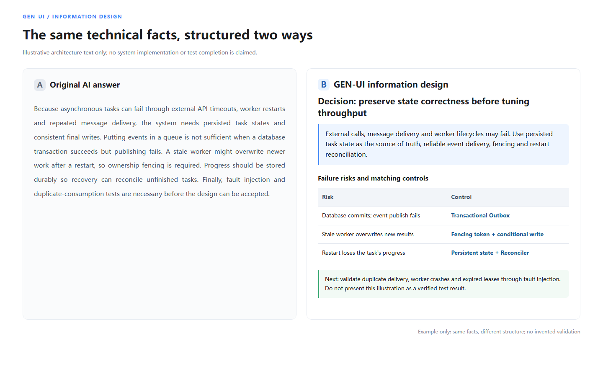
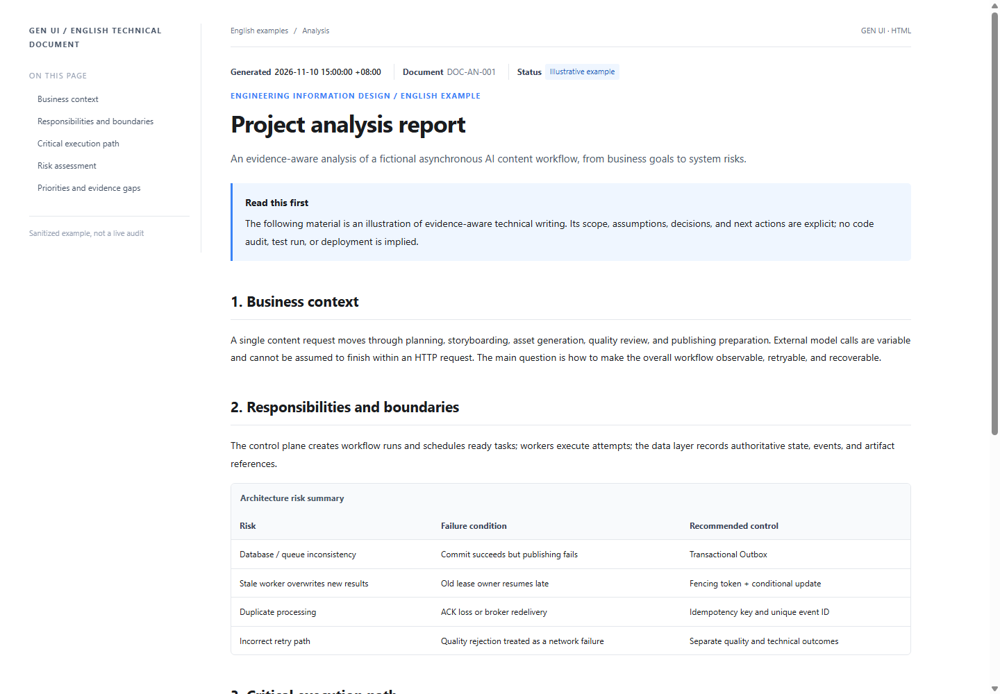
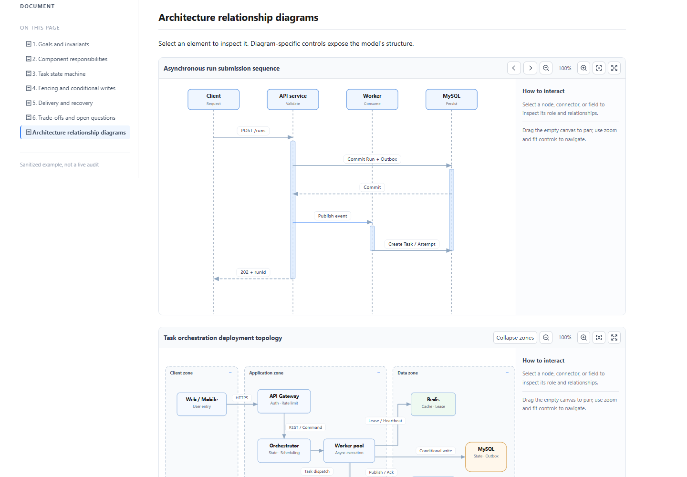
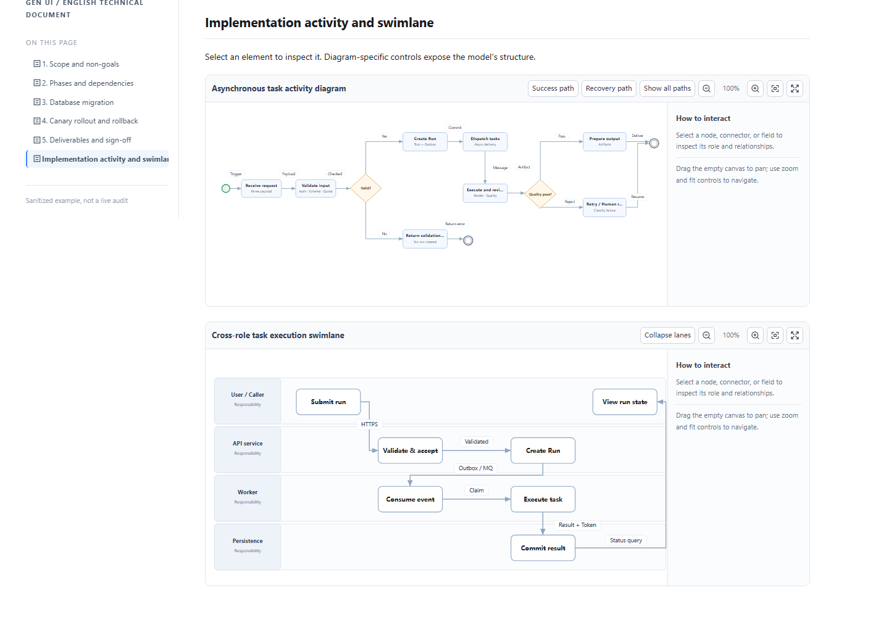
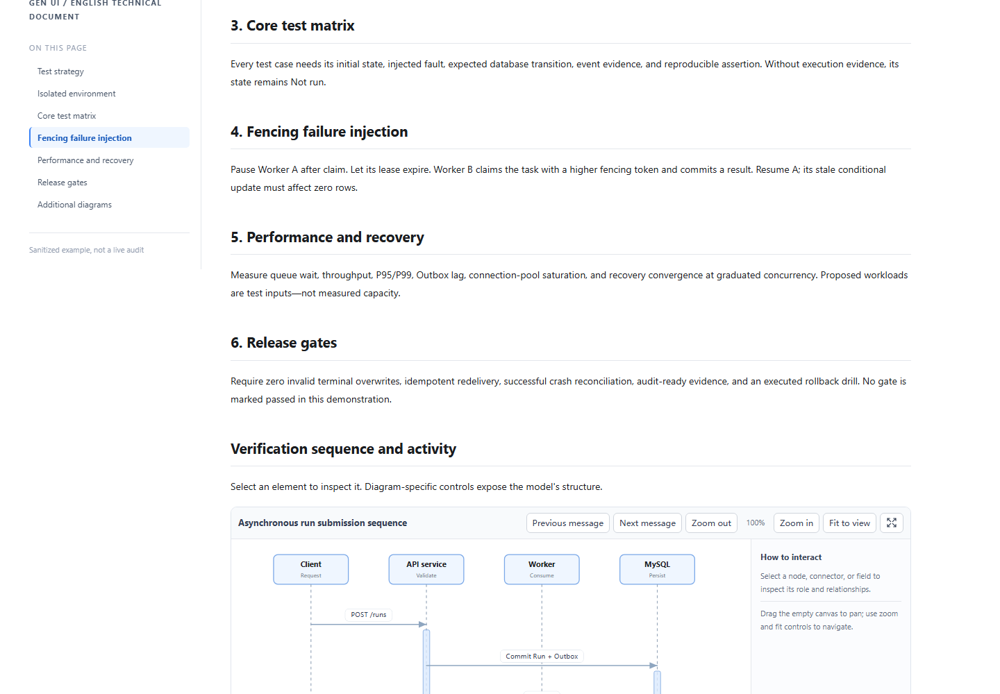
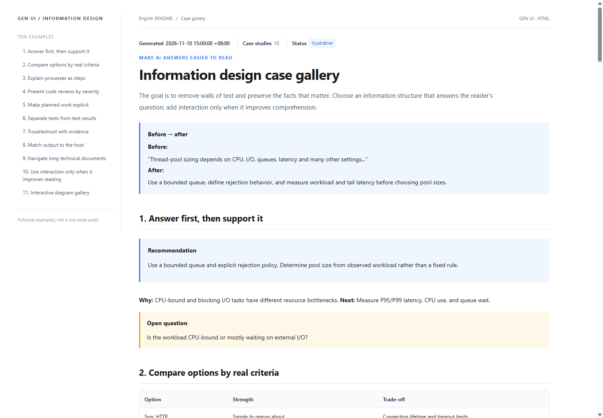
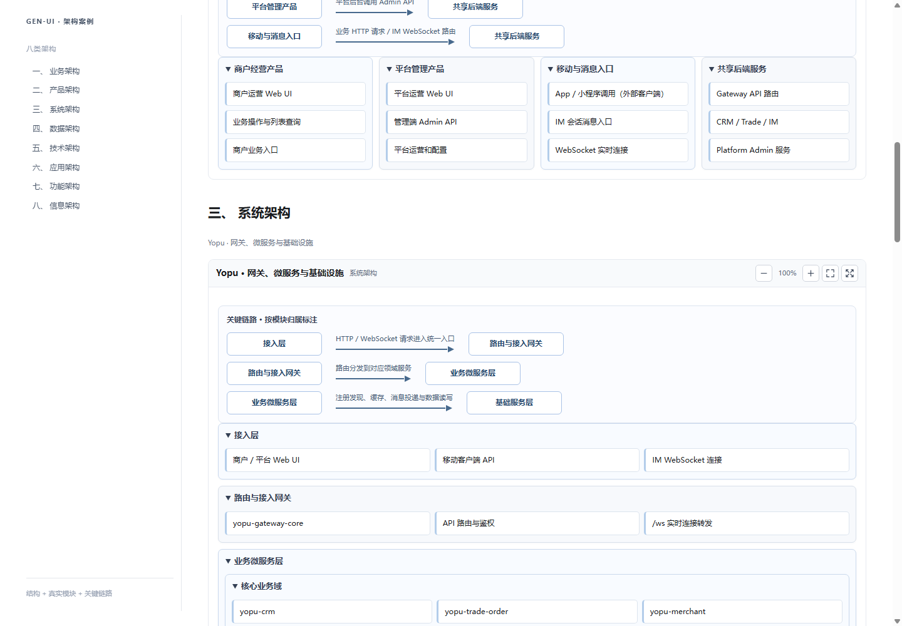

# Gen UI · Make AI answers easier to read and understand

[简体中文](README.zh-CN.md) | **English**

> Transform dense AI output into clear conclusions, structured evidence, meaningful comparisons, and actionable next steps. **Information design, not UI decoration.**

**Gen UI is an information-design Skill for AI coding assistants.** It makes technical explanations, code reviews, architecture decisions, implementation plans, and test evidence easier to follow. Markdown is the default; trusted offline HTML and validated interactive data are used only when the task and host support them.

## Why Gen UI?

| Reading problem | Gen UI approach |
| --- | --- |
| A wall of text hides the conclusion | Answer first; follow with evidence, limitations, and next steps |
| Several options are difficult to compare | Show criteria, trade-offs, and conditional recommendations |
| Dependencies and workflows are hard to picture | Numbered procedures, diagrams, and accessible descriptions |
| Planned work looks like completed work | Explicit statuses, test evidence, and verification boundaries |
| Large datasets hide important records | Relevant filters, pagination, focused columns, and charts |
| The same answer must work across hosts | Host-aware Markdown, diagrams, or trusted offline HTML |

**What matters:** Preserve facts and nuance. Never fabricate tests, code changes, or deployment outcomes. Do not add decorative widgets without a reading purpose.

## Before and after: a technical answer

**Dense answer:** “Thread-pool size depends on CPU, blocking I/O, pool settings, queue capacity, rejection policies, service latency, and various environmental factors, and you should measure and tune it...”

**Gen UI response:** **Conclusion:** Start with a bounded queue and an explicit rejection policy; size the pool using workload measurements. **Evidence:** CPU-bound and blocking tasks have different bottlenecks. **Next:** Measure queue wait, P95/P99 latency, and CPU utilization before tuning.

This is an example of information structure, not production sizing advice.

This real HTML preview compares **the same asynchronous workflow reliability facts** as dense prose versus an answer-first summary, risk/control table, and next action. [View the English Before/After example](demo/before-after.en.html).

## Four complete English HTML examples

The following examples are **English content with English page previews**, not links to Chinese articles. They use one fictional asynchronous AI workflow to demonstrate four distinct reading tasks. These are design examples, not verified audit or benchmark results.

### 01 · Project analysis report

**Preview focus: business mind map.** Context, module responsibilities, workflow boundaries, risks, and recommendations. [Read the project analysis](demo/documents/en/project-analysis.html).

### 02 · System architecture design

**Preview focus: message sequence and deployment topology.** Task states, component responsibilities, fenced execution, transactional delivery, and recovery. [Read the architecture design](demo/documents/en/architecture-design.html).

### 03 · Technical implementation plan

**Preview focus: activity paths and responsibility lanes.** Phases, dependencies, database migration, rollout, rollback, and evidence-based exit criteria. [Read the implementation plan](demo/documents/en/implementation-plan.html).

### 04 · Test and acceptance plan

**Preview focus: test-case matrix and failure injection.** Risk-based test cases, fault injection, performance evaluation, and acceptance gates. [Read the test plan](demo/documents/en/test-acceptance.html).

[**Browse the English document gallery**](demo/documents/en/index.html).

### Ten English information-design examples

[Explore ten English reading scenarios](demo/report.en.html): answer-first summaries, decision tables, procedures, reviews, task statuses, acceptance evidence, troubleshooting, host adaptation, long documents, and purposeful interaction. The [complete interactive Chinese report](demo/report.html) separately demonstrates the full offline HTML control set.

## Semantic diagrams and real interactions (2026-11-10)

The seven diagram types no longer share a generic “boxes + straight lines + dragging” template. Each uses the visual grammar appropriate to its information structure and provides type-specific operations:

- **Sequence:** participants, lifelines, activation bars, synchronous/asynchronous/return messages; select a participant or message to inspect it and step through messages.
- **Mind map:** central topic, branches, child topics, and hierarchy; expand/collapse a branch with mouse or keyboard.
- **Deployment topology:** clients, services, workers, cache, message queue, database, and deployment boundaries; collapse a zone with its nodes and dependent edges.
- **ER:** entity tables, fields, PK/FK markers, and 1:N cardinalities; hide non-key fields and inspect entities, fields, or relationships.
- **Activity:** start/end, actions, decision diamonds, guarded branches, and normal/recovery paths; highlight either path independently.
- **Swimlane:** User, API, Worker, and persistence ownership lanes; collapse a lane and inspect cross-role handoffs.
- **Component:** component boundaries, ports, interface types, and dependencies; toggle ports and highlight component dependencies.

**Shared interaction:** click an element to select it and read its responsibility in the inspector; click an edge to inspect the relationship; drag the empty canvas to pan; use zoom, fit, and fullscreen controls. Node dragging is no longer the only interaction or the default action.

**Connector labels:** use opaque label backgrounds and dedicated label lanes; route connectors around node shapes. SVG bounding-box checks verify labels do not intersect nodes. Image fullscreen controls sit at the image's upper-right corner, and code-copy icons sit at the code block's upper-right corner.

### JSON-powered diagrams and collision-safe labels

All seven SVG diagram grammars can consume a separate local `<script type="application/json" data-diagram-model>` input instead of the built-in examples. See the [custom order-domain ER and sequence diagrams](demo/custom-diagram-model.html) and the [diagram JSON contract](references/semantic-diagram-model.md).

Edge labels use an independent white-background overlay, measured text, and viewport-normalized collision avoidance. Branch collapse hides child nodes **and** connectors; ER field filtering resizes entity boxes. Mobile reading supports an overview/focused mode and fullscreen controls recover from rejected browser API calls.

**Scope:** complex deployment, activity, and component diagrams still require initial node coordinates and connector paths. This is not yet an automatic graph-layout engine.

## Choose the smallest useful output

Route by the requested **deliverable**, not topic keywords: ordinary Q&A, reviews, and unspecified reports default to Markdown. Static offline HTML uses concise essentials; single-file output, complex interaction and semantic diagrams load full contracts only when required.

See [four usage scenarios](docs/usage-examples.en.md) and the [capability routing guide](docs/capability-routing.md). Examples are illustrative, not a claim of successful model or browser tests.

**Dense reading and iterative reviews:** Load [reading layers and review continuity](references/reading-layers.md) only when needed. Lead with changes, evidence, current decisions and unresolved items while keeping full details accessible. Never turn unrun checks into passing evidence or accept nonfatal risks on the user's behalf. Ordinary answers need no fixed summary template.

## Lightweight HTML typography (2026-11-13)

For explicitly requested offline HTML, Gen UI loads the [typography guidance](references/typography.md) and local [`assets/typography.css`](assets/typography.css) on demand. Scope readable prose with `main.genui-typography` and `.genui-prose`; English prose uses a 72ch reading cap; Chinese pages use a wider 62ic cap and natural line wrapping, never balanced wrapping on body paragraphs. **72ch is not a 72-Chinese-character target**. Sidebar folding lets prose use its available reading column, while tables, code and diagrams retain their own scrolling or wide regions. Normal answers remain Markdown-first; no extra runtime dependencies or remote fonts are required.

Static documents reuse `div.doc-layout`, `aside.doc-toc`, `main.doc-main.genui-typography`, a mobile `details.mobile-toc`, and the existing local document CSS/navigation script. To validate a generated HTML artifact:

~~~powershell
node scripts/validate-html-report.mjs path/to/report.html
node tests/chrome-typography-smoke.mjs --generated path/to/report.html
node scripts/accept-html-delivery.mjs path/to/report.html path/to/evidence --require-image
~~~

After tightening the structure contract, three local native Codex representative tasks passed static delivery checks and **18/18 Chrome viewport/sidebar scenarios**; the repository also passed **144/144 Node.js tests**. This is evidence for those samples, not a guarantee for arbitrary model outputs or independent Skill discovery. Native Codex shell reads remained blocked by a local execution policy, so the runner supplied the original Skill text read-only. See the [Chinese blind evaluation and limitations](evals/gen-ui-typography-blind-2026-11-13.md).

**Real HTML interaction gate:** Run Chrome/Edge checks against trusted local HTML to verify navigation, scrolling, the folded M hover/click, the actual centered reading column, image overlays and wheel zoom. It records JSON and screenshots. Omit `--require-image` only when images are not required, and mark image coverage as not exercised. See the [StoryOS acceptance evidence](evals/storyos-real-html-acceptance-2026-11-14.md). The gate also measures compact rail width and brand/destination icon alignment; ordinary Markdown or static delivery does not trigger Chrome automatically.

## Install

Windows PowerShell, Codex:

~~~powershell
git clone https://github.com/yeqiana/gen-ui.git "$HOME\.codex\skills\gen-ui"
~~~

Example agent prompt:

~~~text
Use $gen-ui to explain the asynchronous job system in this repository.
Begin with the conclusion and its evidence. Then show risks and next actions.
Avoid dense text walls; use a comparison table, steps, or a diagram only where useful.
Separate verified findings from assumptions and work that has not been executed.
The current host supports Markdown, not interactive controls.
~~~

Claude Code can load a project-level `.claude/skills/gen-ui/` directory. Installing a Skill does not grant tool access or turn a terminal into an interactive renderer.

## Supported output formats

| Host | Recommended output | Boundary |
| --- | --- | --- |
| Terminal / coding CLI | Structured Markdown | No pretend controls |
| GitHub / IDE | Markdown and supported diagrams | Accessible text fallback |
| Explicit offline HTML request | Trusted local HTML/CSS/JS | Interaction serves reading tasks |
| Configured Webview Renderer | Validated declarative data + Markdown | Host must declare its schema |

Additional **English Markdown examples**: [Java code review](examples/code-review.md), [implementation and acceptance plan](examples/acceptance-plan.md), and [thread-pool explanation](examples/thread-pool.md). You can also explore the [offline portal](demo/portal-pages/index.html) and the [renderer contract](references/renderer-contract.md).

## Verify the examples

~~~powershell
powershell -NoProfile -ExecutionPolicy Bypass -File scripts/test-skill.ps1
node tests/chrome-report-smoke.mjs
node tests/chrome-documents-smoke.mjs
node tests/chrome-semantic-stress.mjs
node tests/chrome-semantic-stress.mjs --mobile
~~~

To refresh all nine current technical-document screenshots from the actual HTML and Chrome renderer, run `node tests/chrome-documents-smoke.mjs --update-previews`. Seeded diagram regression now covers 7 types × 40 models at desktop and mobile widths; it does not prove that every possible diagram is collision-free.

These checks validate fixed, trusted repository examples; they do not establish general model compliance or results from a real project. See [SKILL.md](SKILL.md), [integration](docs/integration.md), and [FAQ](docs/faq.md) for capability and safety boundaries.

MIT License · [LICENSE](LICENSE).

Real-project examples: [Yopu / StoryOS / IM architecture gallery](demo/architecture-patterns.html), covering eight viewpoints and 24 explicit directional relationships. The diagrams are based on local module structures and design documents, not proof of deployed production topology.

See also: [Eight architecture views — layered/container models](demo/architecture-patterns.html) and [Lightweight Skill principles](docs/skill-principles.md).
