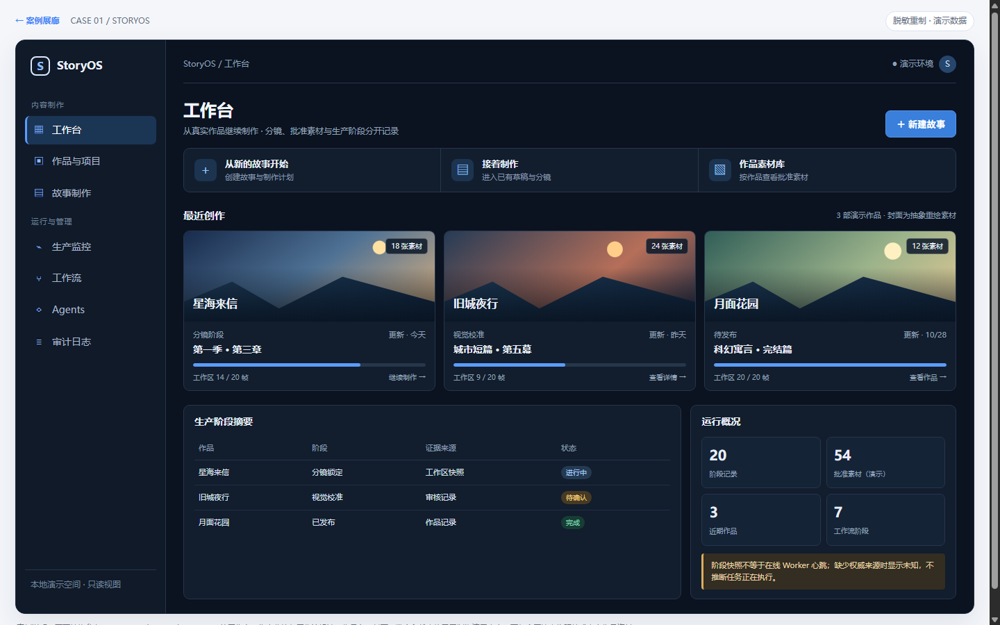
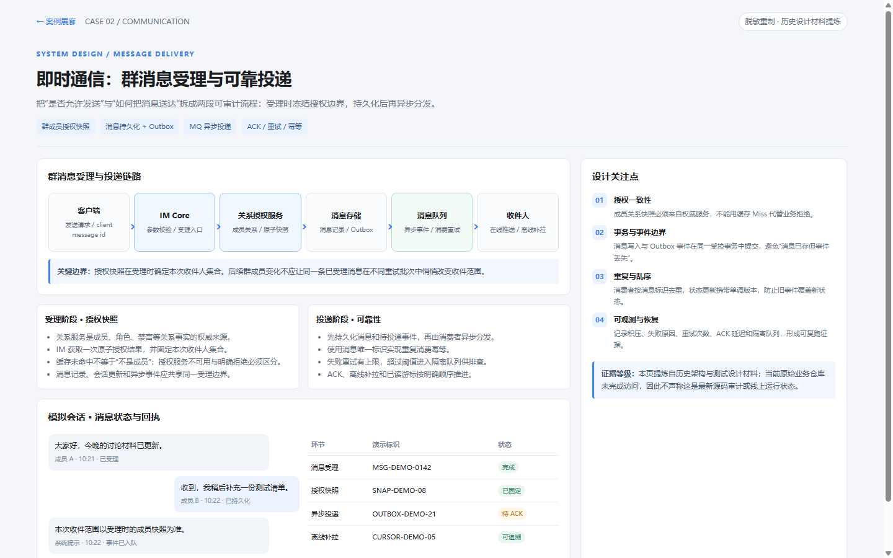
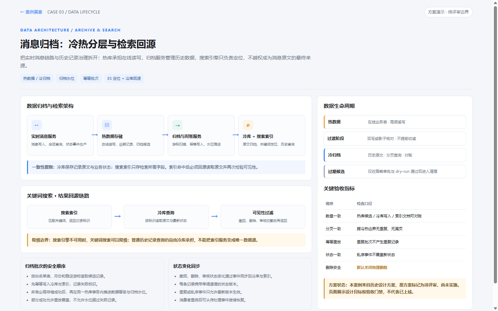
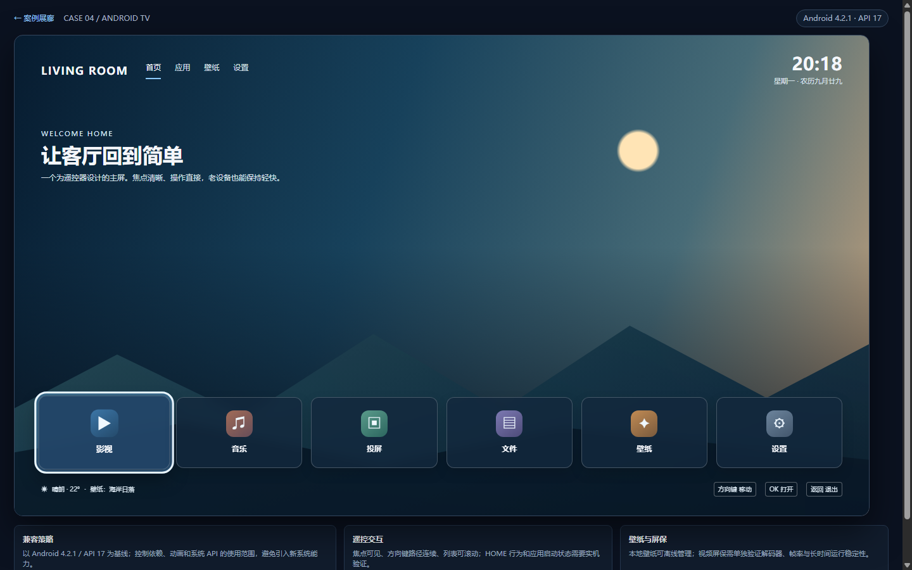
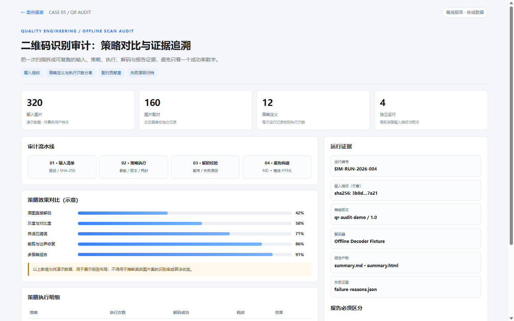

# Gen UI

**简体中文** | [English](README.md)

> 让 Codex、Claude Code、DeepSeek 等 Coding Agent 输出更清晰的 Markdown、工程报告和可离线打开的 HTML 案例。

**Gen UI 是一个 Markdown-first 的 AI Coding 输出 Skill**，不是官方 ChatGPT UI 运行时，也不会因为安装了 Skill 就使终端具备按钮、图表或表单交互能力。它按宿主能力选择可读 Markdown、可验证的结构化 UI 数据，或在明确要求 HTML 时生成离线网页。

## 效果预览 · 五个独立案例

不是占位文字：下面五个案例都提供独立 HTML，可以直接在浏览器打开。README 中的图片由仓库内这些 HTML 的 Chrome 页面截图生成。**所有公开案例均使用合成或重制数据，不复制私有业务源数据。**

### 01 · StoryOS：AI 内容生产工作台

结合 StoryOS Web Console 的工作台、作品库、生产监控和工作流设计：创作入口、作品摘要、素材与阶段记录分离。真实项目结构参考，**作品名、封面、状态与数量均已替换为演示内容**。

[打开 StoryOS HTML](demo/cases/story-workbench.html)

### 02 · 即时通信：群消息受理与可靠投递

根据历史 IM 设计材料重制消息发送链路，展示授权快照、Outbox、MQ、ACK、去重与失败恢复。**不包含原业务品牌、真实群聊、账号或内部接口；不声称完成了当日源码审计。**

[打开 IM 架构 HTML](demo/cases/im-message-flow.html)

### 03 · 冷热库：消息归档和搜索回源

展示热库在线读写、冷库归档、批次水位、幂等重放、ES 定位与冷库回源。原始设计属于**待评审方案**，不是已上线的效果声明。

[打开冷热归档 HTML](demo/cases/cold-archive.html)

### 04 · Android 4.2 TV：旧电视启动器美化

面向 Android 4.2.1 / API 17 的大屏主屏概念：方向键焦点、应用入口、时钟、壁纸和玻璃质感。页面是 **HTML 重绘概念图，不是电视实机截图**；设备地址、网络和个人信息均未包含。

[打开 TV 启动器 HTML](demo/cases/tv-launcher.html)

### 05 · QR Audit：离线二维码识别审计

展示策略统计、输入指纹、运行证据和失败复盘。示例比率与计数全部为虚构数据，**不代表实际扫描识别率**。

[打开二维码审计 HTML](demo/cases/qr-audit-report.html)

[**查看案例展廊（5 个 HTML）**](demo/cases/index.html) · [案例来源与脱敏说明](docs/cases.md) · [Demo 目录说明](demo/README.md)

## 立即使用

### 安装到 Codex（Windows PowerShell）

~~~powershell
git clone https://github.com/yeqiana/gen-ui.git "$HOME\.codex\skills\gen-ui"
~~~

然后在 Codex 中输入：

~~~text
使用 $gen-ui。
分析当前项目的代码、架构和风险，输出中文实施测试验收方案。
先给结论和证据，不能把待执行、已实施和已验收混为一谈。
~~~

Claude Code 可将仓库放入项目的 `.claude/skills/gen-ui/`；其他 Agent 按其 Skill 发现规则安装，或直接读取 `SKILL.md` 和 `references/`。安装不改变 Agent 的工具权限，也不会自动安装 Webview Renderer。

## 支持的输出方式

| 环境 | 默认输出 | 交互条件 |
| --- | --- | --- |
| Codex / Claude CLI / 终端 | Markdown、表格、流程和代码块 | 不假装能点击 |
| GitHub / IDE Markdown | GFM、可选 Mermaid、文本回退 | 宿主支持的 Markdown 预览 |
| 本地 HTML 报告 | 离线 CSS/JS、表格筛选、图表、目录 | 用户明确要求或任务明确选择 HTML |
| 自有 Webview | 受控声明式 JSON + Markdown 回退 | 宿主已经实现并授权安全 Renderer |

HTML 报告的页面行为是**仓库内可信的演示代码**，不是让模型生成任意 JS 并执行。页面默认离线运行；已有 HTML 目录可使用生成器递归集成为 iframe 门户。

## 本地 Demo 与工具

| 演示 / 工具 | 入口 | 用途 |
| --- | --- | --- |
| 业务案例展廊 | [demo/cases/index.html](demo/cases/index.html) | 五个脱敏业务 HTML 成品 |
| 工程质量分析报告 | [demo/report.html](demo/report.html) | 离线筛选、表格、图表、分页、抽屉 |
| 多文件 HTML 门户 | [demo/portal-pages/index.html](demo/portal-pages/index.html) | 多级目录、真实 iframe 和移动导航 |
| 声明式 UI 协议 | [demo/index.html](demo/index.html) | 受控滑块和教育用途 `gen-ui-demo/v1` |
| 目录门户生成器 | [scripts/build-html-portal.mjs](scripts/build-html-portal.mjs) | 将现有 HTML 递归整合为门户 |

~~~powershell
# 现有目录内没有 index.html 时
node scripts/build-html-portal.mjs --dir "D:\reports" --title "工程报告"

# 已有手工维护的 index.html：生成独立 portal.html，避免覆盖
node scripts/build-html-portal.mjs --dir "D:\reports" --output "D:\reports\portal.html"

# 本地可信页面需要启用 JS / 表单时，使用沙盒化 HTTP 预览
node scripts/serve-html-portal.mjs --dir "D:\reports"
~~~

直接通过 `file://` 打开门户属于静态沙盒预览，子页面脚本不执行；本地 HTTP 模式启用脚本、表单但**不授予 iframe 同源权限**。更多见 [HTML 报告契约](references/html-report-contract.md)、[Renderer 协议](references/renderer-contract.md)、[集成指南](docs/integration.md)。

## Markdown 基础案例

除 HTML 外，也保留 [Java 代码评审](examples/code-review.md)、[实施验收计划](examples/acceptance-plan.md) 和 [线程池解释](examples/thread-pool.md) 三个可在 CLI/IDE 直接阅读的示例。它们是示范文本，不代表执行过当前业务测试。

## 验证与质量门禁

~~~powershell
powershell -NoProfile -ExecutionPolicy Bypass -File scripts/test-skill.ps1
node tests/chrome-report-smoke.mjs
node tests/chrome-portal-smoke.mjs
node tests/chrome-cases-smoke.mjs
~~~

这些测试验证的是**仓库内的固定示例**，不是任意模型输出的安全性或真实业务部署。当前版本的 Model/Agent 独立盲测与正式 Release 需要分别核实；详见 [真实 Agent 证据](evals/webcodex-agent-matrix-2026-11-06.md)与[发布门禁](docs/release-readiness-v1.4.0.md)。

## 仓库结构

~~~text
SKILL.md                 Skill 入口与输出规则
references/              HTML 报告与受控 Renderer 契约
demo/cases/              五个脱敏业务 HTML + 截图与展廊
demo/                    工程质量报告、目录门户、受控协议示例
examples/                代码评审、实施验收与线程池 Markdown 示例
docs/                    集成说明、案例溯源、FAQ、GEO
tests/                   Node 测试与固定浏览器回归
evals/                   真实 Agent 与浏览器验收证据
scripts/                 校验、门户生成与本地预览
~~~

**边界：** Gen UI 管输出呈现，不替代项目的代码规范、运行权限、真实测试、脱敏审查或发布审批。未经验证的设计写成方案，不写成已上线。更多见 [FAQ](docs/faq.md) 和 [GEO 说明](docs/geo.zh-CN.md)。GEO / 搜索可发现性效果尚**未测量**，README 展示不意味着搜索排名或 AI 引用率已提高。

MIT License · [LICENSE](LICENSE).
