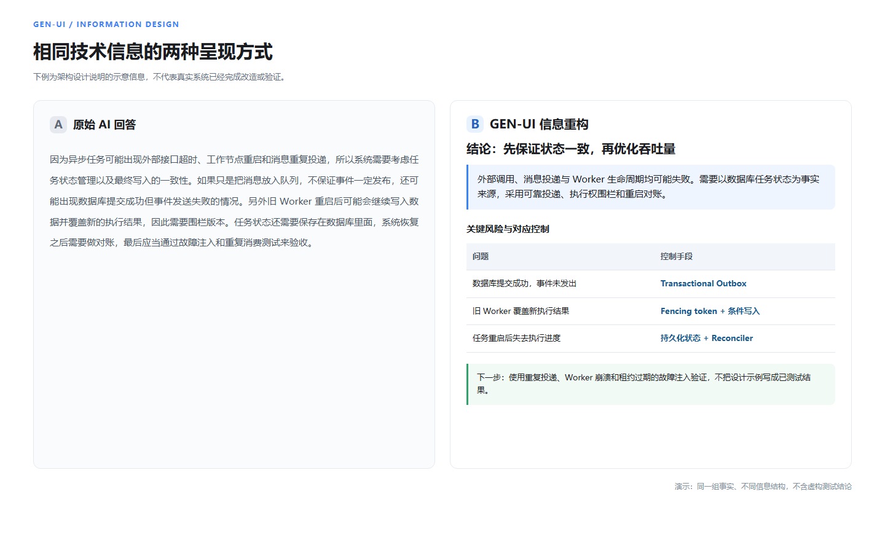
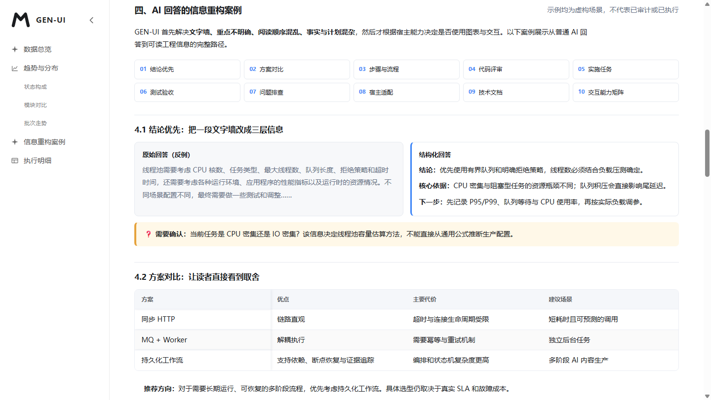
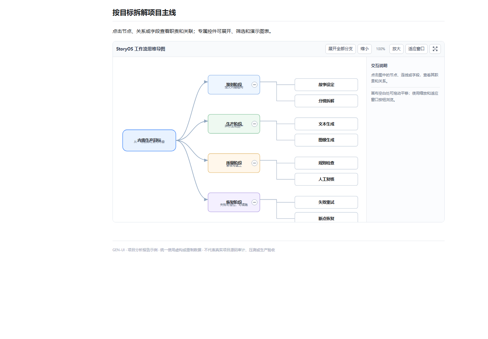
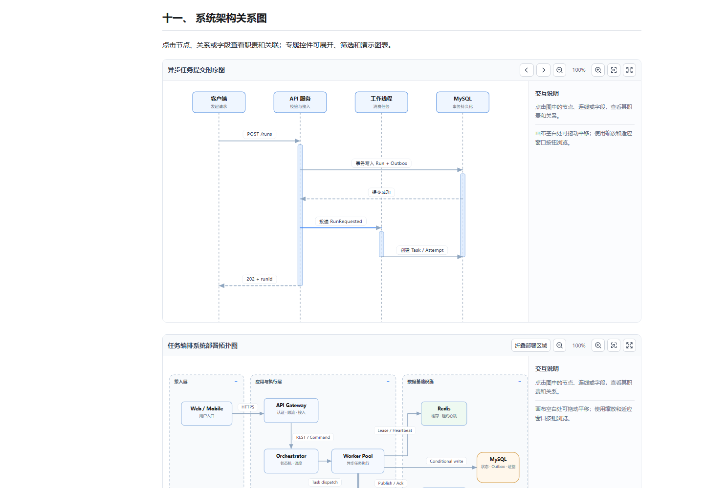
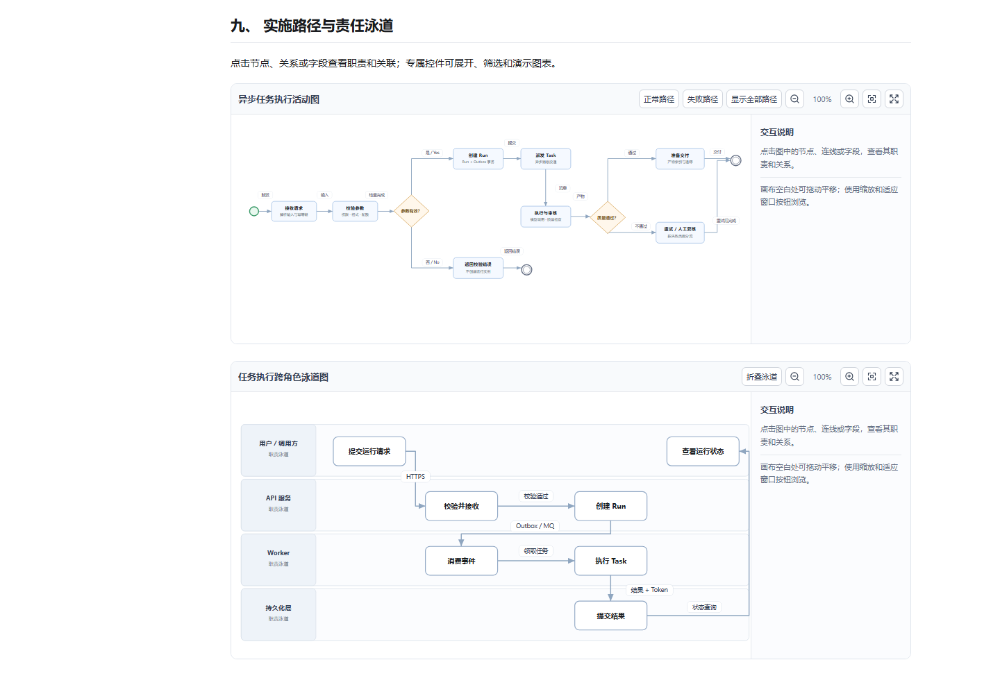
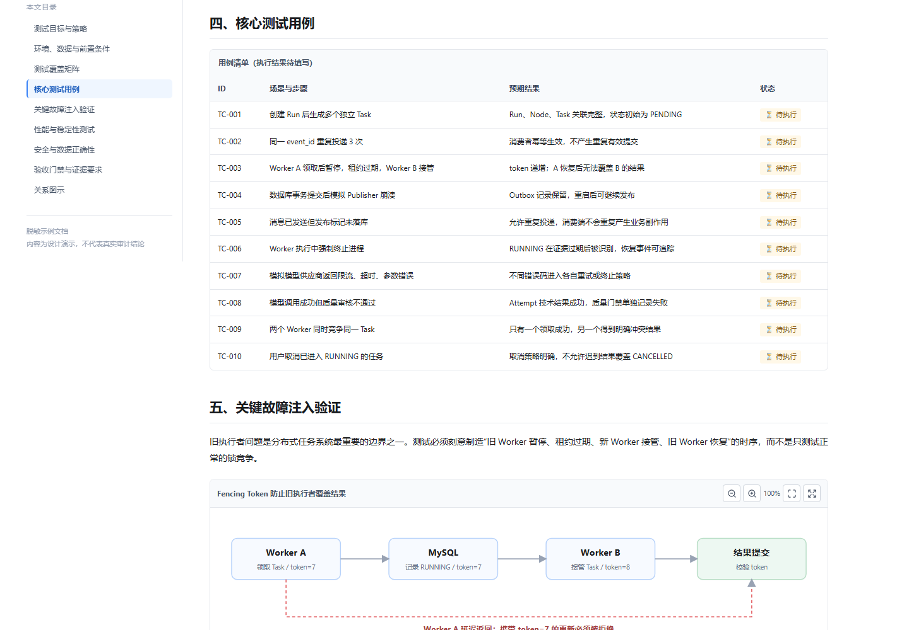

# Gen UI · 让 AI 回答更容易理解

**简体中文** | [English](README.md)

> 把冗长、密集、难以快速理解的 AI 回答，整理成有结论、有层次、有证据、有下一步的内容。**不是单纯美化 UI。**

**Gen UI 是面向 AI Coding Agent 的信息组织与阅读体验 Skill。** 它通过选择恰当的信息结构，改善代码评审、架构说明、实施计划、测试验收、技术分析和日常解释的阅读体验。优先使用宿主可直接阅读的 Markdown；只有在明确需要且宿主支持时，才使用离线 HTML 或经过验证的声明式交互。

## 为什么需要 Gen UI？

同一份技术信息，长段叙述并不一定有利于理解。Gen UI 关注读者的实际问题：

| 常见阅读问题 | Gen UI 的处理方式 |
| --- | --- |
| 一大段文字，看不到结论 | 先说结论，再给证据、限制和下一步 |
| 多个方案混在一起，难以取舍 | 使用对比表，明确优点、代价与推荐条件 |
| 流程、模块依赖关系难理解 | 编号步骤、架构图、SVG 流程图与文字说明 |
| 已完成、待执行和失败混在一起 | 状态标识、验收清单与可核查的证据 |
| 大量记录，找不到关键数据 | 图表、相关字段筛选、分页、列隐藏与长文本浮层 |
| 回答无法在终端和网页间复用 | 根据宿主选择 Markdown、静态图示或受控 HTML |

**原则：不减少必要事实，不编造执行结果，不为了美观增加无意义组件。**

## 先看一个回答重构示例

**普通回答：** “线程池需要考虑 CPU、IO、线程数、队列、拒绝策略、性能指标、运行环境，还需要根据情况做压测和调整……”

**使用 Gen UI 后：** **结论：** 先采用有界队列与明确的拒绝策略；线程数量根据任务类型和实际负载测试确定。**依据：** CPU 密集与阻塞型任务的瓶颈不同。**下一步：** 采集队列等待、P95/P99 与资源利用率，再进行调优。

这是信息组织方式的示例，不是生产环境的线程池配置建议。

这张截图使用**同一组异步任务可靠性信息**做左右对比：左边是长段文字，右边把结论、风险和下一步拆开；[打开中文对比 HTML](demo/before-after.zh.html)。

## HTML 完整展示 · 十类阅读场景

[**查看交互式完整报告**](demo/report.html) · 包含结论提炼、方案对比、执行步骤、代码评审、实施任务、测试验收、排障分析、宿主适配、技术文档导航、功能覆盖矩阵共 **10 类案例**。

在同一份 HTML 中，还可以体验与阅读直接相关的功能：状态多选与模块批次级联、滑块、图表、表格列隐藏和分页、截断提示、代码块一键复制、离线 SVG 缩放/拖动/全屏、弹窗与抽屉、导航、秒级生成时间及底部公开引用。

## 四份中文工程技术文档

四份 HTML 围绕**脱敏的异步 AI 内容生产平台**，展示从理解项目到验收交付的完整链路；这些是**设计与分析示例**，不是对某个私有仓库的实时扫描结论。

### 01 · 项目分析报告

**截图重点：业务思维导图。** 业务背景、模块职责、系统边界、领域模型、核心链路与风险。 [阅读项目分析](demo/documents/project-analysis.html)

### 02 · 系统架构设计方案

**截图重点：消息时序与部署拓扑。** 任务状态机、模块边界、Outbox、执行权围栏和断点恢复。 [阅读架构设计](demo/documents/architecture-design.html)

### 03 · 技术实施方案

**截图重点：活动路径与责任泳道。** 阶段计划、依赖关系、迁移、灰度、回滚与验收门禁。 [阅读实施方案](demo/documents/implementation-plan.html)

### 04 · 测试与验收方案

**截图重点：测试用例矩阵与故障注入。** 覆盖矩阵、故障注入、待执行用例、性能测试计划和证据要求。 [阅读测试验收](demo/documents/test-acceptance.html)

[浏览全部中文技术文档](demo/documents/index.html) · [Demo 目录说明](demo/README.md)

## 真实语义图表与交互（2026-11-10）

七类图不再复用同一种“方框 + 直线 + 拖动”模板。每一类都使用与其信息结构相匹配的 SVG 图形语法，并提供对应操作：

- **时序图**：参与者、生命线、激活条、同步/异步/返回消息；点击参与者或消息查看详情，上一条/下一条逐步演示。
- **思维导图**：中心主题、分支、子主题和层级连接；点击分支上的展开控件折叠/展开，支持键盘操作。
- **部署拓扑图**：客户端、应用服务、Worker、缓存、消息队列、数据库及部署边界；点击区域折叠节点和关联连线。
- **ER 图**：实体表、字段、PK/FK 标记和 1:N 关系；支持隐藏普通字段、选择实体/字段/关系并查看说明。
- **活动图**：开始/结束、动作、判断菱形、条件标签及正常/异常路径；可单独高亮正常路径或失败恢复路径。
- **泳道图**：按用户、API、Worker、持久化层划分责任泳道；点击泳道折叠/展开，检查跨角色交接。
- **组件图**：组件边界、端口、接口类型和依赖关系；支持端口显隐、组件选择与依赖高亮。

**共同交互：** 单击元素进行选择，右侧检查器显示职责和关系；点击连线可检查关系；空白画布拖动平移，工具栏缩放、适应窗口和全屏。节点拖动不再是唯一交互，也不作为默认操作。

**连线标签规则：** 标签有不透明背景和独立布局通道，路径绕开节点；通过 SVG 几何检测确认标签不与节点相交。图片全屏按钮固定在图片右上角，代码复制图标固定在代码块右上角。

### JSON 驱动与动态避让

七类图现可通过页面内 `<script type="application/json" data-diagram-model>` 接收独立业务数据，而不依赖内置示例。新增 [订单 ER 与订单消息时序案例](demo/custom-diagram-model.html)；结构约定见 [语义图表 JSON 契约](references/semantic-diagram-model.md)。

连线标签使用独立白底图层、文本真实测宽及可视坐标碰撞调整，覆盖节点—标签、标签—标签。思维导图折叠会同时处理子节点和连线，ER 字段隐藏时实体外框同步收缩。移动端提供**全图概览 / 聚焦阅读**切换，全屏状态支持异常恢复。

**边界：** 复杂部署图、活动图等仍需提供初始节点位置和连线路径；不应把此功能宣传为完全自动布局引擎。AI 应先提取真实节点和关系，并执行浏览器遮挡验收。

## 能力路由：先选择合适的输出

根据**明确交付物**而不是技术关键词选择：普通问答、代码评审及未指定格式的“报告”默认 Markdown；简单静态 HTML 使用轻量规范；复杂交互、真正独立单文件或专业语义图按需加载完整合约。

参见 [四种任务使用示例](docs/usage-examples.md) 和 [能力路由与加载边界](docs/capability-routing.md)。示例仅展示推荐形态，不表示实测通过。

**信息密度与多轮评审：** 只有长文难以阅读或需要续接多轮评审时，按需读取 [阅读分层与评审续接](references/reading-layers.md)：先交代本轮变化、结论、关键证据和未决项，完整细节仍可追溯。普通回答不增加固定摘要或章节；未运行测试不能写成已验收，非致命缺陷必须由有权决策者知情接受。

## 轻量 Typography 与离线 HTML 排版（2026-11-13）

仅在明确要求离线 HTML 时，GEN-UI 才按需加载 [轻量排版规则](references/typography.md) 和本地 [`assets/typography.css`](assets/typography.css)。正文建议使用 `main.genui-typography` 与 `.genui-prose`，英文使用 72ch 阅读宽度基准，中文改用 46ic 并对短段落均衡换行，避免几个字孤立在末行；**72ch 不代表 72 个汉字**。导航展开/折叠后正文仍保持阅读行宽，表格、代码和图表继续使用独立的横向空间。

静态技术文档复用 `div.doc-layout`、`aside.doc-toc`、`main.doc-main.genui-typography`、移动端 `details.mobile-toc` 及仓库已有的本地文档 CSS/导航脚本，不添加新的框架或远程字体。确需单文件 HTML 时内联小型排版规则，普通问答仍默认 Markdown。

可以对实际生成的 HTML 运行以下交付门禁：

~~~powershell
node scripts/validate-html-report.mjs path/to/report.html
node tests/chrome-typography-smoke.mjs --generated path/to/report.html
~~~

本地原生 Codex 在三类代表性 HTML 任务的无强化提示验证中，经规则收口后通过静态检查及 **18/18 个 Chrome 视口/目录状态场景**；仓库回归有 **144/144 项 Node.js 测试**通过。该结论限于已测样本，并非未来所有生成结果的合规保证。原生 Codex 的本地命令读取仍受执行策略阻挡，评测由 Runner 只读提供 Skill 文件正文。详见 [盲测与已知边界](evals/gen-ui-typography-blind-2026-11-13.md)。

## 安装与使用

Windows PowerShell 中安装到 Codex：

~~~powershell
git clone https://github.com/yeqiana/gen-ui.git "$HOME\.codex\skills\gen-ui"
~~~

在 Coding Agent 中输入：

~~~text
使用 $gen-ui，先识别读者真正要解决的问题。
分析当前项目的异步任务链路，先给结论、关键依据、风险，再列出下一步。
避免长段文字墙；必要时使用表格、步骤或流程图。
明确区分已验证事实、待确认假设和待执行任务。
当前宿主只有 Markdown，不要生成不可操作的按钮。
~~~

Claude Code 可放入项目的 `.claude/skills/gen-ui/`，其他 Agent 可按照其 Skill 机制读取 `SKILL.md` 和 `references/`。安装 Skill 不会自动获得系统权限或让终端支持交互控件。

## 输出模式与更多示例

| 宿主 | 推荐输出 | 说明 |
| --- | --- | --- |
| 终端 / Codex / Claude CLI | 结构化 Markdown | 结论、列表、表格、代码与证据 |
| GitHub / IDE | Markdown、可支持的图示 | 保留文本说明与无图回退 |
| 明确要求的离线 HTML | 自带 CSS/JS 的可信本地文件 | 交互只用于提升阅读和探索效率 |
| 已配置的 Webview Renderer | 校验过的声明式 UI + Markdown | 必须由宿主声明能力 |

中文 Markdown 例子：[Java 代码评审](examples/code-review.zh-CN.md) · [实施验收计划](examples/acceptance-plan.zh-CN.md) · [线程池解释](examples/thread-pool.zh-CN.md)。

其他演示：[离线多页门户](demo/portal-pages/index.html) · [声明式协议教学示例](demo/index.html) · [HTML 规范](references/html-report-contract.md)。

## 验证

~~~powershell
powershell -NoProfile -ExecutionPolicy Bypass -File scripts/test-skill.ps1
node tests/chrome-report-smoke.mjs
node tests/chrome-documents-smoke.mjs
node tests/chrome-semantic-stress.mjs
node tests/chrome-semantic-stress.mjs --mobile
~~~

如需从真实 HTML 和 Chrome 重新生成当前 9 张技术文档截图，运行 `node tests/chrome-documents-smoke.mjs --update-previews`。七类专业图现覆盖每类 40 份固定种子业务模型及桌面/移动端回归，但不等于所有输入都绝对无碰撞。

测试仅验证**仓库内的固定示例**；不等于真实目标项目已通过审计、执行或发布。关于安全边界、宿主适配与操作许可，参见 [SKILL.md](SKILL.md)、[集成说明](docs/integration.md) 和 [FAQ](docs/faq.md)。

MIT License · [LICENSE](LICENSE)。

真实项目案例：[Yopu / StoryOS / IM 八类架构视图](demo/architecture-patterns.html)。按实际模块分层，并展示 24 条带方向的关键协作链路；图中是结构与设计资料的示意，不代表生产环境部署验收。

延伸阅读：[八类架构图的分层/容器示例](demo/architecture-patterns.html) · [轻量化 Skill 设计原则](docs/skill-principles.md)。
