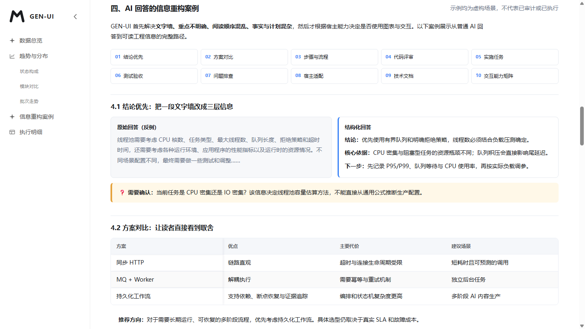

# GEN-UI Demo：AI 回答的信息组织与阅读体验

本目录的演示目标是：**让 AI 生成的复杂信息更容易理解、定位和执行**，而不是把一切内容都转成 UI。默认先按内容选择结构，再根据宿主能力决定是否启用 HTML 交互。

## 主案例：完整的中文 HTML 信息重构报告

**[demo/report.html](report.html)** 汇总 Skill 的主要设计规则，并将它们映射到实际可操作的页面：

| 分类 | 对应示例 | 解决的问题 |
| --- | --- | --- |
| 结论优先与重点标识 | 4.1 文字墙前后对比、顶部关键结论 | 重要内容淹没在长段落中 |
| 对比决策 | 4.2 方案对比表 | 无法快速看清利弊与适用条件 |
| 步骤与关系 | 4.3 编号步骤、顶部 SVG | 流程顺序与模块依赖难理解 |
| 代码评审与复制 | 4.4 严重级别、位置、SQL 代码块 | 无法快速定位修复建议 |
| 任务进度 | 4.5 七种任务状态语义 | 计划、失败与已完成混淆 |
| 测试验收 | 4.6 测试矩阵、证据边界 | 把待执行写成已通过 |
| 故障排查 | 4.7 症状、假设、证据、行动 | 排查缺乏可执行顺序 |
| 宿主适配 | 4.8 CLI、IDE、HTML、Webview | 输出形式与宿主能力不匹配 |
| 技术文档导航 | 4.9 四份完整中文文档 | 长篇文档难阅读与跳转 |
| HTML 交互能力 | 4.10 覆盖矩阵、原有图表与记录 | 数据量大、页面宽、缺少聚焦 |

**保留的实际交互：** 模块→批次级联、状态多选、搜索、耗时滑块、图表联动、每页 10 条分页、列显隐、截断浮层、按钮与表单、弹窗与抽屉、离线 SVG 全屏/缩放/拖动、代码复制、个人 IP favicon，以及带秒的生成时间。示例数据是虚构的，页面不向服务端提交操作。

**关系图演示：** 主报告和对应技术文档提供七类真实语义 SVG：时序图、思维导图、部署拓扑、ER、活动图、泳道图和组件图。每类均有专属交互（消息逐步演示、分支展开、部署区折叠、字段显隐、路径高亮、泳道折叠、接口端口显隐），点击节点/连线可查看说明；空白画布可平移，支持缩放和全屏。连线标签有独立白底并通过边界框检测避让节点。图片全屏按钮位于图片右上角，代码复制 icon 位于代码块右上角。

## 四份完整中文技术文档

| 文档 | 内容 |
| --- | --- |
| [项目分析报告](documents/project-analysis.html) | 背景、模块、架构、领域模型、风险与建议 |
| [系统架构设计](documents/architecture-design.html) | 状态机、组件职责、一致性、Outbox、断点恢复 |
| [技术实施方案](documents/implementation-plan.html) | 阶段任务、依赖、迁移、灰度、回滚 |
| [测试与验收方案](documents/test-acceptance.html) | 用例矩阵、故障注入、性能计划、验收证据 |

[浏览中文文档目录](documents/index.html)

## Four English document examples

English readers get **English prose, headings, tables, browser previews, and instructions**—not Chinese content behind an English README:

| English example | Purpose |
| --- | --- |
| [Project analysis report](documents/en/project-analysis.html) | Context, risks, ownership and recommendations |
| [System architecture design](documents/en/architecture-design.html) | State, fencing, Outbox and recovery |
| [Technical implementation plan](documents/en/implementation-plan.html) | Phases, dependencies and rollback |
| [Test and acceptance plan](documents/en/test-acceptance.html) | Cases, fault injection and evidence gates |

[Browse English document examples](documents/en/index.html)

## 其他演示与固定测试夹具

- [demo/index.html](index.html)：`gen-ui-demo/v1` 受控声明式协议教学（滑块演示，不是通用运行时）。
- [portal-pages/index.html](portal-pages/index.html)：递归目录、iframe 沙盒和移动导航的固定浏览器夹具。
- `report.js`、`report-refinements.css`、`flow-viewer.js`、`documents/assets/`：主示例使用的可信离线实现和共享样式。
- [Skill HTML 规范](../references/html-report-contract.md)：颜色、排版、链接、表格、图表、表单、代码与安全边界。

## 本地复验

~~~powershell
powershell -NoProfile -ExecutionPolicy Bypass -File scripts/test-skill.ps1
node tests/chrome-report-smoke.mjs
node tests/chrome-documents-smoke.mjs
~~~

页面样本可通过本地浏览器离线查看。所有声称的测试通过情况只适用于本仓库的固定测试，不代表虚构业务系统已完成审计、压测或发布。
